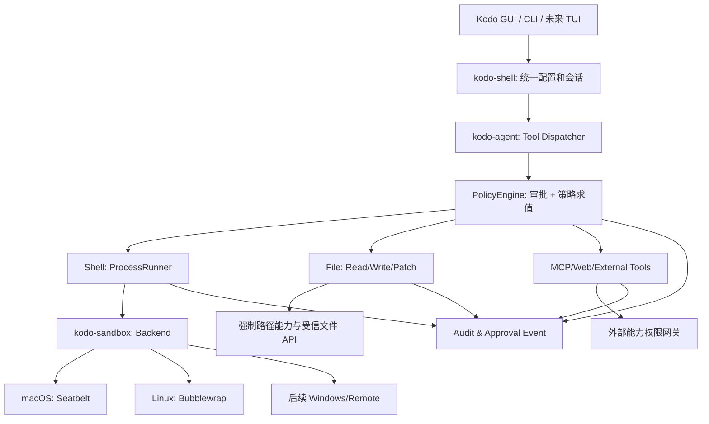

# Kodo Secure Execution V1：沙箱能力设计与实施方案

> 状态：实施设计草案（供 Claude Code 在仓库中落地）  
> 评估日期：2026-10-21  
> 目标仓库：[ljx240/kodo](https://github.com/ljx240/kodo)  
> 首期平台：macOS、Linux；Windows 在后续阶段单独设计  
> 核心原则：**轻量、独立、默认受限、失败关闭、可验证、不破坏现有 CLI/GUI/Agent 行为**
>
> **实施状态（2026-10-21）**：P0-A / P0-B / P0-C / P0-D 已落地，
> 实现见 `crates/sandbox`，平台能力矩阵、验证方式与剩余风险见
> `docs/design/SECURE_EXECUTION.md`。macOS 已用真实进程实测通过；
> Linux 后端已实现但本机无 `bwrap`，**尚未功能验证**。

---

## 0. 执行摘要

**决策：需要增加沙箱，优先级 P0，但无需立即引入 Docker、虚拟机或全套插件系统。**

Kodo 已拥有 Ask/Auto/Full 审批、Shell 命令风险分类、路径检查、受控环境变量、统一进程超时和取消、ChangeSet/Undo 等基础能力。然而，命令审批只判断“执行前是否授权”，并不能约束已被授权的 `npm test`、`cargo build`、`python script.py` 以及它们派生的子进程对主机文件、网络和凭据的访问范围。

采用以下三条正交轴：

1. **ApprovalPolicy**：`Ask | Auto | Full`；保留现有含义，但不能绕过强制沙箱边界。
2. **SandboxMode**：`ReadOnly | WorkspaceWrite | Unrestricted`；控制文件访问效果与执行空间。
3. **EnforcementCapabilities**：实际生效能力报告，分别描述**文件读、文件写、网络隔离**的 `full / partial / unsupported`，不能用模糊的“已启用沙箱”代替。

首期目标：在安全边界成立时，常规构建/测试可在工作区沙箱内减少重复审批；敏感、外部、越界或破坏性操作继续审批。**审批通过不代表越权操作自动可执行；必须经过明确、仅本次有效的升级流程。**

### 本期不做

- 不重写 Agent Loop，不改变 LLM Provider、Memory、Skills 核心架构。
- 不要求全部用户安装 Docker/Podman。
- 不做泛化的容器调度/微 VM/SSH 云工作节点。
- 不承诺 Windows 7 32 位原生安全沙箱支持。
- 不把 Shell 文件隔离等同于所有 File/MCP/Web Tool 的隔离。
- 不追求对任意恶意本地代码的形式化安全证明；明确受支持威胁模型和不支持的攻击类别。

---

## 1. 当前仓库基线与审计结果

下列结论基于 2026-10-21 检查的 `main` 文件；**实施前须重新检查 HEAD 和项目现状，文件路径可能变化。**

| 现有模块 | 路径 | 可复用能力 | 需补充 |
|---|---|---|---|
| Rust Workspace | `Cargo.toml` | 统一 crate 管理 | 增加 `crates/sandbox` |
| Agent 请求 | `crates/agent/src/lib.rs` 的 `RunRequest` | 现有 `permission: Permission`、审批回调与工具入口 | 注入解析后的沙箱策略/执行上下文 |
| 统一命令执行 | `crates/agent/src/process.rs` 的 `ProcessSpec` / `ProcessRunner` | 子进程创建、超时、取消、输出大小限制、进程组 | 通过后端生成受限命令；避免旁路执行 |
| Shell 工具 | `crates/agent/src/tools.rs` 的 `command_run` | 风险分类、环境变量白名单、read-only Git 防护 | 每次运行必须携带并校验执行策略 |
| 文件工具 | `crates/agent/src/tools.rs`、`crates/agent/src/patch.rs` | `resolve_in_project` 路径规范化、敏感路径规则、变更记录 | 统一策略；处理符号链接/路径竞争和可写根权限 |
| CLI/GUI 共用配置 | `crates/shell/src/config.rs` 的 `ShellConfig` | 权限与 Provider 解析 | 增加 Sandbox 配置解析和有效状态 |
| CLI | `crates/cli/src/args.rs` | `--permission` | 增加 `--sandbox` 与 `--sandbox-status`（如果与 CLI 风格一致） |
| 审批记录 | `crates/shell/src/approve.rs` | 审批指纹与会话决策 | 指纹纳入具体策略、操作范围、单次越权能力 |
| Git 工作流程 | `AGENTS.md` | 工作分支/Worktree/合并/审查约束 | 保持原规则，禁止自动推送、自动清理和覆盖 |

### 1.1 实际代码线索（供定位）

- `ProcessSpec` 包含 `cwd`、`command`、`timeout`、`env`、`stdout_limit`、`stderr_limit`。
- `ProcessRunner::run()` 当前通过 `shell_command(&spec.command)` 构建 `/bin/sh -c` 或 `cmd /C`，然后 `spawn()`。
- `command_run()` 通过 `ProcessSpec::shell(...).env(agent_env_policy())` 调用 `ProcessRunner::run()`。
- `Permission::needs_approval()` 与 `CommandRisk` 负责审批，但并非 OS 级隔离。
- Unix `setpgid()` 主要用于终止进程树，不是文件/网络沙箱；Windows 主要通过 `taskkill /T /F` 尝试终止树。
- 现有 `resolve_in_project()` 是应用层文件路径保护，不对 Bash 子进程生效。
- 命令环境变量采用显式白名单，但 `HOME`、`PATH`、`HTTP_PROXY` 等仍会影响凭据读取与网络行为，需要在沙箱上下文重新约束。

### 1.2 威胁模型

**需要防范：**

1. 模型选择了看似正常、实际上含恶意生命周期脚本的命令（`npm test`、`pip install`、`cargo build` 等）。
2. 项目依赖或测试脚本越界修改用户主目录、邻近仓库、配置或密钥文件。
3. 子进程通过网络泄漏项目外凭据或受保护资料。
4. Shell 中的路径跳转、相对路径、软链接、硬链接或嵌套 Shell 绕过应用层判断。
5. CLI、GUI、定时任务、MCP 子进程使用了不同入口，某一入口意外绕过审批或沙箱。
6. 沙箱探测失败时静默以非沙箱形式继续执行。
7. 多个 Agent 误修改同一工作现场，或 Worktree `.git` 指针导致外部元数据被误写。

**暂不保证：**对抗内核零日、root/管理员身份执行、主机守护服务代办网络访问、硬件侧信道、所有语言运行时反沙箱技巧；另需文档说明对应残余风险。仓库应禁止以 root 身份开启常规自动沙箱作业，遇到高风险环境降级为阻止或要求外部隔离执行。

---

## 2. 竞品技术决策对照

| 产品 | 有价值的参考 | 重要边界 | Kodo 决策 |
|---|---|---|---|
| OpenAI Codex | 将 `sandbox_mode` 与 `approval_policy` 明确分离；只读/工作区写入/不受限 | 具体覆盖随执行环境变化 | 学其正交权限模型与受保护路径策略 |
| Claude Code | macOS Seatbelt、Linux Bubblewrap、代理网络过滤、沙箱命令及其后代 | Shell 沙箱不能自动涵盖所有内建工具/MCP | 学其轻量双隔离与减少日常审批的交互 |
| DeepSeek Harness | `ctx.sandbox` 能力接口、`sandboxPolicy`、后端独立、`full/partial` 强制执行状态 | `SandboxMode` 主要控制文件效果，不直接保证网络 | 学其接口与能力报告，不照搬插件式系统 |
| Kodo 现状 | Rust Core/Agent/Shell/CLI + Tauri GUI + 统一 `ProcessRunner` | 有审批但缺 OS 级强制隔离 | 新增轻量 `kodo-sandbox` crate，不大改 Agent |

**一项重要区分：** DeepSeek Harness 文件沙箱与 Claude Code 网络沙箱能力不应简单混合成“一个沙箱模式”，Kodo 应分别声明 `filesystem.read`、`filesystem.write`、`network.egress` 的覆盖程度。

参考资料：

- Codex 基础配置与沙箱/审批概念：https://developers.openai.com/zh-Hans/docs/config-file/config-basic
- Claude Code Sandboxing：https://code.claude.com/docs/en/sandboxing
- Anthropic Sandbox Runtime：https://github.com/anthropics/sandbox-runtime
- DeepSeek Harness 沙箱说明：https://github.com/deepseek-ai/deepseek-harness/blob/master/docs/subsystems/sandbox.zh.md
- DeepSeek Harness sandbox-local 说明：https://github.com/deepseek-ai/deepseek-harness/blob/master/packages/sandbox/sandbox-local/README.md

---

## 3. 总体架构



**安全边界：** `kodo-agent`、`kodo-shell`、LLM 凭据和运行态日志属于受信控制平面；Shell 执行中的项目代码/依赖/测试属于不可信执行平面。不能把控制平面的 API Key 注入 Shell 环境，不能让不可信进程直接修改 Kodo 的用户设置、凭据与会话日志。

### 3.1 模块目录（建议）

```text
crates/
  sandbox/
    Cargo.toml
    src/
      lib.rs
      policy.rs          # 解析后的不可变策略
      capabilities.rs    # 检测当前平台实现覆盖程度
      backend.rs         # trait + 运行前准备
      macos.rs           # Seatbelt 受限子进程
      linux.rs           # Bubblewrap 受限子进程
      audit.rs           # 不含密钥的结构化事件
    tests/
      policy.rs
      confinement.rs
      failure.rs
  agent/
    src/process.rs       # 引入 ExecutionSpec/Sandbox backend
    src/tools.rs         # command_run 策略注入
    src/lib.rs           # RunRequest 引入沙箱会话上下文
  shell/
    src/config.rs        # 共享配置和严格校验
    src/approve.rs       # 审批和一次性策略提升
  cli/
    src/args.rs          # 可选 --sandbox 等
  ...
```

文件组织可根据现有代码风格调整；**不要先移动原有模块或者重写进程系统**。

### 3.2 核心接口草案（示意，不要求逐字复制）

```rust
pub enum SandboxMode {
    ReadOnly,
    WorkspaceWrite,
    Unrestricted, // 显式确认；不调用受限后端
}

pub enum EnforcementLevel {
    Full,
    Partial,
    Unsupported,
}

pub struct CapabilityReport {
    pub backend: String,
    pub file_read: EnforcementLevel,
    pub file_write: EnforcementLevel,
    pub network_egress: EnforcementLevel,
    pub notes: Vec<String>,
}

pub struct SandboxPolicy {
    pub mode: SandboxMode,
    pub workspace_root: std::path::PathBuf,
    pub allowed_read_roots: Vec<std::path::PathBuf>,
    pub denied_read_roots: Vec<std::path::PathBuf>,
    pub allowed_write_roots: Vec<std::path::PathBuf>,
    pub denied_write_roots: Vec<std::path::PathBuf>,
    pub network: NetworkPolicy,
    pub require_full_enforcement: bool,
}

pub enum NetworkPolicy {
    DenyAll,
    // 仅在真的存在不可绕过的受控代理时启用
    AllowDomains(Vec<String>),
}

pub trait SandboxBackend: Send + Sync {
    fn inspect(&self) -> Result<CapabilityReport, SandboxError>;
    fn prepare(
        &self,
        program: &std::path::Path,
        args: &[std::ffi::OsString],
        policy: &SandboxPolicy,
    ) -> Result<PreparedCommand, SandboxError>;
}
```

设计要求：

- `prepare()` **只返回受限执行计划**，不得实际执行；`ProcessRunner` 负责 spawn、cancel、timeout、stream limits，避免生成第二套进程管理器。
- 一次运行中策略不可被模型修改。默认 `WorkspaceWrite`；只有显式受信用户动作可提升策略。
- `PreparedCommand` 不应通过字符串拼接 Shell 命令生成；存储 `program + argv + env + cwd + protected profile path`，避免参数注入。
- 若 `NetworkPolicy::AllowDomains` 暂时做不到强制边界，则拒绝开启此模式；不能仅靠设置 `HTTP_PROXY` 就宣称实施网络限制。
- `Unrestricted` 必须有显眼的用户确认，并在日志中标注：`sandbox_bypassed=true`。
- 完整约束以 backend `inspect()` + 实际运行探测为准，支持 `Unavailable`/`Partial`/`Full` 的区分。

### 3.3 典型调用流

```text
模型提出工具调用
  → Tool Dispatcher 辨识操作/目标/意图
  → PolicyEngine：权限、当前项目、文件/网络白名单、敏感数据要求
  → 普通可执行：准备受限 argv；执行；记录结果
  → 拒绝：生成结构化拒绝原因
  → 可升级：向用户说明操作、越界范围、单次风险并请求授权
  → 用户批准：为该操作创建一次性 capability/token
  → 执行一次，立即失效；回写审计事件
```

### 3.4 必须覆盖的入口

需要实施前主动枚举：

- `command_run`；所有 `ProcessRunner::run` 调用，包括特殊 Git 查询、核验命令、安装命令、终端。
- 在 Agent 主循环直接调用的任何 `Command::new`/第三方 Spawn，梳理是否受信系统进程，禁止模型命令旁路。
- Agent 文件读取、写入、Patch、删除与外部附件。
- MCP stdio 服务进程：要么受沙箱策略控制，要么明确分类为外部受信扩展并逐项授权；**不得无提示自动继承工作区全部权限**。
- MCP 远程 HTTP、内置 WebSearch、Provider LLM HTTP：控制平面流量与不可信 Shell 流量必须分开，不能为了允许模型 API 而开放任意脚本网络。
- 定时调度/非交互模式：未提供可确认用户时越权即阻止，不可默认提升。

---

## 4. 策略与兼容设计

### 4.1 正交组合

| Approval | Sandbox | 行为 |
|---|---|---|
| Ask | WorkspaceWrite | 审批每次需审批的调用，执行仍受工作区和网络限制 |
| Auto | WorkspaceWrite | 通过策略认定为允许的普通调用可自动在沙箱运行；敏感操作审批 |
| Full | WorkspaceWrite | 不能扩大文件/网络范围；本来须审批的危险行为仍按策略评估 |
| 任意 | ReadOnly | 禁止源工作区写入；工具运行所需临时区由 backend 授予 |
| 显式用户授权 | Unrestricted | 单次或明确限时会话绕过；不可静默自动开启 |

现有 `Permission::Full` 的语义是**减少审批**而不是“OS 无限权限”。如果改变现有行为可能破坏兼容，应先加迁移提示与专项回归。

### 4.2 路径政策

- 对工作区与允许根目录做规范化；不可信输入不得添加任意主机路径。
- 默认拒绝 Kodo 自身运行数据、凭据目录、`~/.ssh`、`~/.aws`、Shell 历史等可识别敏感目录。不能仅凭扩展名判断秘密，也不能暗示全部秘密都被识别。
- 使用 Worktree 时，额外处理 `.git` 文件指向**其他目录**的 Git common dir；禁止通过变更 Worktree 文件间接打开 Git 元数据写权限。
- 对文件写入使用最小权限；必要时采用 OS 安全文件描述符级操作（Linux `openat2`/`O_NOFOLLOW` 等）或专门受信 Worker，以免校验之后路径被替换（TOCTOU）。不应该宣称单独的 `canonicalize()` 已彻底解决此类问题。
- 必须定义构建缓存、包管理缓存、TMP、`HOME`：可考虑单会话隔离 HOME/临时目录，默认不把真实用户 HOME 整体挂入可读空间；明确安装/测试兼容问题。
- `ReadOnly` 是**宿主工作区只读**，不等于进程没有任何写能力：受限私有临时区仍可供必要的运行时使用。

### 4.3 网络政策

P0 的可靠范围：**默认阻止不可信 Shell 子进程所有出站网络**。Linux 优先通过 network namespace 强制隔离；macOS 通过 Seatbelt 网络规则加功能性试验实现拒绝。拒绝情况必须以真实探针验证，而非相信环境变量。

P1 才引入域名级授权：受信任本机代理 + 禁止直连 + HTTP CONNECT/SOCKS 策略 + 域名/SNI 校验、DNS 和 IPv6 绕过测试，并区分当前执行器允许访问的 Provider 网络；针对 JVM/原生客户端不遵循代理变量的情况，使用网络强制边界兜底。

禁止默认开放 `127.0.0.1`、Unix domain socket、Docker Socket、SSH Agent、系统 keychain 服务。若测试服务需要端口，走按目标、按会话的显式授权策略，并在对应平台验证。

### 4.4 沙箱失败语义

- backend 不可用、探针失败、强制执行低于策略要求：`SandboxUnavailable` / `SandboxPartialEnforcement`，**fail closed**。
- `PermissionDenied`、`ExecutionRejected` 与命令返回非 0 应保留不同错误类别。
- 不能未经授权直接把 `WorkspaceWrite` 改为 `Unrestricted`。
- CLI 非交互运行时，未确认或超出范围的行为直接失败并附必要诊断。
- 不支持某平台时可启动 Kodo 的浏览与对话，但执行受保护命令必须阻止，或通过显式选择的受信远程后端执行。

---

## 5. 平台技术方案

### 5.1 macOS：Seatbelt（P0）

目标：封装 `sandbox-exec` 的 Seatbelt profile，在**进程创建之前**完成文件和网络限制，子进程继承限制；策略模板要避免过宽的文件访问。重点测试 Apple Silicon，针对 `sandbox-exec` 已弃用、后续系统版本变化设置探测和替代路线。

- `WorkspaceWrite`：系统必要只读目录 + 显式允许的项目写根 + 私有 TMP/HOME + 拒绝敏感数据读取。
- `ReadOnly`：只读项目 + 私有临时目录；无网络。
- 使用 profile 文件时必须放在私有、安全权限目录，生成后不可被受限子进程改写，执行结束清理。
- shell/编译工具兼容性要实测（`cargo test`、Node/Vite、Java、Git）。
- 严格测试对子进程、非 `/bin/sh` 编译进程、重定向、符号链接及 loopback 网络的约束。

### 5.2 Linux：Bubblewrap（P0）

首选 `bwrap`，需要能创建用户/挂载/网络命名空间，宿主内核和容器环境不保证具备该能力。必须执行功能探针，不能只检查二进制存在。

- `--ro-bind` 只读系统环境，显式 `--bind` 工作区和受限 TMP；`--unshare-net` 禁止出站直连。
- 评估 PID namespace、procfs、`/dev`、宿主运行时缓存、路径映射及 symlink。不要只用 `--ro-bind / /` 就声称机密文件不可读；要额外遮蔽或不挂载敏感路径。
- 尽量阻断 Docker Socket、SSH Agent、凭据挂载及主机任意目录。
- 当 userns/bwrap 不可用时拒绝受限运行。Landlock 可作为后续实验性替代方案；旧内核 ABI 需报告部分覆盖，不可宣称完整隔离。

### 5.3 Windows / Win7 32 位（后续）

不在 P0/P1 中假装支持。Windows 原生可研究受限令牌、Job Object、ACL、AppContainer/WFP 等，但它们不是一种简单的文件写入限制，且可能出现部分强制执行及权限迁移风险。现代 Windows 需求独立设计并执行操作系统矩阵测试。**Windows 7 32 位优先考虑薄客户端 + 现代 Linux Remote Runner**，不以不成熟原生沙箱作为安全承诺。

---

## 6. GUI/CLI 体验要求

首期保持 UI 极简，仅显示真正有价值的状态：

```text
会话：Kodo Code  ·  工作区写入  ·  网络禁止  ·  [查看限制]
运行 cargo test → 沙箱内执行（自动/经审批）
请求访问 /Users/.../Documents → 已阻止，说明原因 / 申请单次允许
```

- Settings 增加 Sandbox 默认档位、运行状态（完整/部分/不可用）、网络策略说明，默认不出现复杂高级表单。
- Inspector/Trace 追加受限运行、被拒绝、授权提升的结构化事件；避免记录明文秘密、完整环境变量或原始网络凭据。
- CLI 可显示简洁 banner：`Sandbox: workspace-write (files: full, network: full)`；具体字段必须来自能力报告，不是手写固定文案。
- CLI 提供 `--sandbox read-only|workspace-write|unrestricted` 时，最后一项需要醒目的风险确认；非交互默认禁止未经明确配置/授权的切换。
- 审批框必须明确目标命令/操作、被保护范围、拟放宽项和“仅允许本次”的生效范围。

---

## 7. 实施任务拆分

### P0-A：先建立最小安全内核

**改动**：新建 `kodo-sandbox`；定义 `SandboxMode/Policy/Capabilities/Error`、策略解析和后端接口；配置贯通 `ShellConfig → RunRequest → ProcessSpec`。

**验收**：默认 `WorkspaceWrite`，缺失配置不变成无限制；未知配置值拒绝或回退到受限安全默认且有明确诊断；CLI/GUI 使用同一解析逻辑。

### P0-B：macOS/Linux 的强制执行与 ProcessRunner 接入

**改动**：Seatbelt/bwrap 两个后端；在进程创建前生成 `program + argv` 执行计划；复用原 ProcessRunner 的取消/超时/输出收集。调用路径统一，不允许 `command_run()` 特殊分支绕过。

**验收**：工作区写入成功，项目外写入失败；默认网络尝试失败；子进程同样失败；正常构建与测试不大面积损坏；缺少执行后端时拒绝受限任务。

### P0-C：文件工具、MCP 与授权网关清点

**改动**：为 FileRead/FileWrite/Patch/Delete 提供统一的路径策略入口；梳理外部附件、MCP stdio、远端 MCP、Web/Provider；区分受信控制平面流量与模型执行平面。

**验收**：文件工具无策略旁路；MCP 权限未明确覆盖时须额外审批或禁止；未提供强制读隔离的平台须准确报告保护程度。

### P0-D：审批升级、审计、失败关闭

**改动**：运行结果中记录沙箱后端/能力/拒绝原因；为越界请求定义一次性授权 token，token 绑定 session ID、操作哈希、作用域、超时时间；耗尽即销毁。保留 `Ask/Auto/Full` 原有行为的兼容测试。

**验收**：授权一次不能复用到其他命令、其他路径、其他子 Agent、其他会话；非交互执行不能自动授权；审计不包含 API Key。

### P1：安全域名代理、低打扰执行与体验优化

仅在 P0 OS 强制隔离可靠以后，引入真正网络代理/目标授权；细化前端显示、网络限制详情、政策调试；基于测试和实际审核信号，决定是否把普通沙箱命令默认改为自动执行。**不要为了“少审批”提前削弱隔离。**

### P2：多 Agent + Worktree

独立 Worktree 会话与沙箱策略；按工作树保护 Git common dir；子 Agent 默认继承且只能收窄权限；合并统一由受信 Git 协调路径执行，不能静默清理其他 Agent 变更。限 CPU/内存/时间为可选能力并声明平台覆盖。

### P3：容器/远程执行

单独抽象远程 Executor/Workspace，不挤进 `SandboxBackend` 的同进程安全接口。容器/远程空间的文件同步、结果提取、源代码保护、成本、网络与凭据管理需要独立威胁建模。

---

## 8. 测试矩阵与验收门槛

| 测试用例 | 预期 | P0 必须 |
|---|---|---|
| 工作区正常写入 | 成功 | 是 |
| 项目外 `touch`/写入 | 被 OS 级限制拒绝，文件不存在 | 是 |
| `ReadOnly` 下修改源码 | 被拒绝 | 是 |
| `npm test`/脚本产生子进程跨目录写入 | 子进程也被拒绝 | 是 |
| 访问 `~/.ssh`、真实 HOME 凭据 | 被保护或准确报告未覆盖 | 是 |
| 直接 TCP/HTTP、DNS/IPv6、localhost 绕路 | 默认网络策略下不可出网；分类清楚 | 是 |
| 文件工具符号链接越界写入 | 被拒绝，原文件不变 | 是 |
| Hard link/TOCTOU 路径攻击 | 根据具体承诺阻止或标注不支持并 fail closed | 是 |
| `.git` / Git common dir / `.kodo` 修改 | 不因开放工作区根目录而放行 | 是 |
| `ProcessRunner` timeout/cancel | 沙箱后代可靠结束，无孤儿进程 | 是 |
| bwrap/Seatbelt 缺失或探针失败 | fail closed，明确错误 | 是 |
| 一次性审批升级使用 2 次 | 第二次被拒绝 | 是 |
| CLI 非交互/定时运行需要提权 | 拒绝而非默认授权 | 是 |
| LLM Provider 调用 | 正常（与子进程网络隔离区分） | 是 |
| MCP stdio 外部工具 | 隔离或明确风险提示；无旁路 | 是 |
| GUI/CLI 共享配置 | 解析与最终策略一致 | 是 |
| Windows 实际强制隔离 | 后续专项 | 否 |
| 域名白名单 HTTPS/SOCKS/JVM | P1 | 否 |

**最低质量门槛：**

1. 新增策略单元测试与沙箱真实环境集成测试；平台不可用时标记为 `skipped-unavailable`，不得伪造通过。
2. 现有 `cargo fmt --all -- --check`、相关 `cargo check`、`cargo test` 通过。
3. `cd apps/desktop && npm run typecheck && npm run build` 在 UI 受影响时通过；必要时运行视觉测试。
4. `Ask/Auto/Full` 历史行为不出现无提示扩大权限；已有 Checkpoint/Undo 与 Git 操作流程回归通过。
5. 如后端失败，应证明**没有启动未受限进程**；包括 Git 快捷路径、verify path、MCP stdio 的审计。
6. 记录测试所用 OS/内核、沙箱依赖版本、命令行和结果；不能把 macOS 通过标成 Linux 已验证。

---

## 9. 风险与权衡

| 风险 | 严重程度 | 对策 |
|---|---|---|
| `sandbox-exec` 已弃用 | 中高 | 后端可替换、运行时探测、留迁移空间；不要承诺长期不变 |
| Linux 不允许 unprivileged user namespaces | 高 | 功能探针、明确依赖、拒绝受限执行；后续考虑备选后端 |
| 缓存/TMP/Java/Node 工具链受限 | 中 | 私有 HOME/TMP、必要只读系统路径、构建兼容测试 |
| 写沙箱仍能读取项目外密钥 | 高 | 文件读取保护与网络保护单列能力，不以 write-only 冒充强沙箱 |
| Shell 受限但工具 API 绕过 | 高 | 所有入口策略门禁，区分受信与不可信执行平面 |
| 通过 loopback、Unix socket 绕过网络策略 | 高 | 功能探针、禁止默认 Socket 暴露、P1 代理严格校验 |
| Git worktree 元数据指向外部 | 高 | 单独受信 Git 接口 + `.git`/common dir 保护 |
| 过多用户弹窗导致可用性下降 | 中 | 先确保自动执行真的受 OS 限制，再减少常规审批 |
| 需要修改大量历史 `RunRequest` 构造点 | 中 | 受控迁移、集中 Factory/default 和编译期检查，不增加任意兼容旁路 |

---

## 10. 对 Claude Code 的执行约束

实施时严格遵循仓库根目录 `AGENTS.md`、`CLAUDE.md`（如存在）及工程文档：

1. 开始前检查 `git status --porcelain=v1`、`git worktree list --porcelain`、`git branch --no-merged main`、`git stash list`、基线提交；明确既有未提交改动归属，禁止覆盖。
2. 默认从**已核验的本地 main** 创建一个任务分支：`feat/secure-execution-v1`；不因普通任务自动新建 Worktree。
3. 不自行执行 `git reset --hard`、`git checkout --`、`git clean -fd`、`stash drop/clear`、强制推送、自动合并等高风险操作。
4. 先完成只读代码审计、列出所有受影响的 spawn/文件/网络入口；再按 P0-A/B/C/D 小步修改。
5. 遇到某项强制隔离当前环境确实无法实现时，保留安全失败行为，不能用“可运行但无沙箱”的占位实现冒充完成；在结果中说明未完成项。
6. 提交、推送、创建 PR、合并等操作严格遵循既有规则；**未明确授权不自动修改远程仓库或合入 main**。
7. 每阶段给出改动文件、风险、测试结果和未覆盖平台；最后提供安全能力矩阵与可回退策略。

---

## 11. 最终完成定义（Definition of Done）

- [ ] 工作区沙箱策略、应用层审批、OS 强制能力独立建模。
- [ ] CLI/GUI/Agent 主路径贯通并保持行为一致。
- [ ] macOS/Linux 至少一项完整实测，其余平台准确标注且不能误宣传；计划支持的另一项应在目标平台验证后才声明完成。
- [ ] 默认禁止不可信 Shell 出站网络，已用实际网络探针验证。
- [ ] 工作区外文件写入和关键读取限制通过真实执行验证。
- [ ] 子进程不可绕过沙箱，进程取消与超时保持有效。
- [ ] 内建文件工具和 MCP 等入口完成覆盖审计，不存在已知未经处理旁路。
- [ ] Backend 不可用时 fail closed，没有非沙箱回退。
- [ ] 单次越权授权不可跨命令/会话复用。
- [ ] 单元、集成、回归测试执行并记录真实结果。
- [ ] 更新 README、CLI 帮助、设置说明、安全模型与平台兼容说明。
- [ ] 保持代码轻量，没有引入非必要容器平台或全套插件架构。

**结束。**
