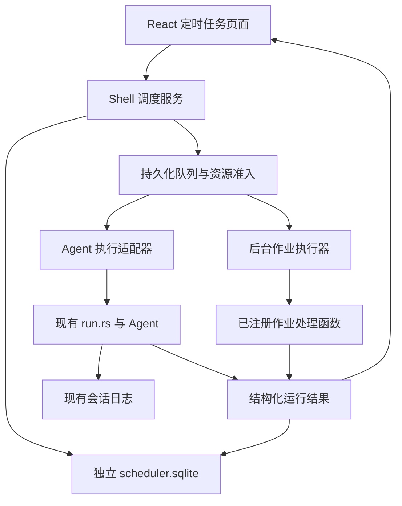

# Kodo 定时任务功能实现方案

> 日期：2026-10-13（Asia/Shanghai）
>
> 状态：设计与实施依据；功能代码尚未实现，文中的测试是验收计划，不代表已经通过。
>
> 项目目录：`/Users/lijianxue/work/WorkSpace/kodo`

## 1. 已确认的需求与边界

用户已经确认以下事项：

1. 同时支持定时触发 Agent 执行任务，以及通用后台作业。
2. 首版仅在 Kodo 进程运行时执行；应用重启后按规则处理漏执行。
3. 当前工作区已有的修改、未跟踪文件、分支和两条 stash 全部原样保留，可以结合当前代码分析。
4. 本次文档准备阶段的授权是本地分析和文档输出，尚未执行功能实现。后续用户明确发起实施后，本地功能修改按实施请求推进；该请求不自动授权增加依赖、联网、提交、合并、推送或创建 PR。

首版覆盖：一次执行、固定间隔、每天、每周；创建、编辑、暂停、恢复、立即执行、取消本次运行、归档、运行历史和关联结果。

高级 Cron、应用退出后的独立后台服务、系统唤醒、多机调度和云端执行属于后续范围。同步、清理、备份可通过已注册作业扩展；每个实际业务处理器仍需单独实现和验收。

## 2. 分析基线与现有能力

本地已提交主线与当前工作区需要分别识别，不能把未提交的 Memory 功能当成已经存在于 main 的能力。

| 项目 | 本轮检查结果 |
|---|---|
| 本地 HEAD / main | `f888923a96fcd539251c3017533f9c4b3819c807` |
| 本地缓存 origin/main | `8a429c0d3981042bd8dbc62482839f254d736550` |
| 远程新鲜度 | 未联网、未 fetch，未核验 |
| 当前主工作目录 | `/Users/lijianxue/work/WorkSpace/kodo` |
| 既有现场 | 30 个已跟踪修改、11 个未跟踪条目；条目包含目录，不等同于文件总数 |
| 历史 stash | `stash@{0}`、`stash@{1}` 均保留 |

已有能力及接入点：

| 位置 | 可复用能力 | 调度接入需要补充 |
|---|---|---|
| `apps/desktop/src-tauri/src/main.rs` 的 send_message | 会话创建、上下文检查、配置加载、Agent 选择 | 复用准备逻辑，避免调度器修改全局设置或绕过检查 |
| `apps/desktop/src-tauri/src/run.rs` 的 Runs / start | 运行代次、取消、审批、线程执行、run:event | 后端结果回调、任务来源、结构化终态、共享资源准入 |
| `crates/core/src/session.rs` | 会话日志、执行轨迹、终态及中断恢复 | 关联 task_id / task_run_id，支持恢复核对 |
| `crates/core/src/line.rs` | 现有 append-only 日志机制 | 当前 append 不提供任务领取与游标推进的组合事务，调度使用独立存储 |
| `crates/shell/src/config.rs` | 桌面与 CLI 的共享配置 | 任务级 Provider / 模型选择及权限上限 |
| `crates/agent/src/process.rs` | 子进程超时、取消、输出上限 | 接入任务整体 deadline，确认子进程退出后释放资源 |
| 当前未提交的 `crates/memory/src/outbox.rs` | 本地 Memory 回放 | 稳定后注册为后台作业，补取消检查与完整结果统计 |
| `apps/desktop/src/routes.ts`、Sidebar、App | 现有路由与外壳 | 定时任务入口、页面和数据刷新 |

关键事实：

- 当前主线没有时间触发的定时任务模块。
- Runs 只防止同一会话重复执行，不能防止不同会话同时操作同一项目。
- run::start 返回成功仅表示执行线程已启动，不代表任务执行成功。
- Agent 的 delivery、verification 与回合生命周期相互独立，调度结果必须保留这些语义。
- 当前 Memory 模块已使用 rusqlite，但尚未提交并合入 main；不能擅自带入或提交其既有改动。

## 3. 总体架构

采用本地持久化调度器，接入两类执行器。沿用 Core / Shell / Tauri / React 分层，首版不新增独立调度 crate。



| 层 | 新增或扩展职责 |
|---|---|
| Core | 任务定义、时间规则、状态、运行结果；保持模型与 Tauri 无关 |
| Shell | 存储、时间计算适配、调度循环、队列、重试、资源锁、执行器契约 |
| Tauri | 启动与停止调度服务、命令与事件、复用现有 Agent 运行驱动 |
| CLI | 复用项目资源准入；首版不启动另一个调度循环，不增加后台 daemon |
| React | 列表、表单、时间预览、运行历史与结果跳转 |

React 的 setInterval 不承担实际触发职责。页面关闭、路由切换或 WebView 刷新不改变调度状态；Kodo 进程退出后停止调度。

## 4. 时间规则

### 4.1 首版类型

| 类型 | 数据 | 语义 |
|---|---|---|
| Once | 一次执行的 UTC 时间戳 | 形成一个计划触发；结束后保留结果，手动重跑使用新触发标识 |
| Interval | anchor_utc、interval_seconds | 按 anchor + k × interval 计算，不以执行结束时间为新起点 |
| Daily | 本地时刻、IANA 时区 | 按保存的时区每天计算 |
| Weekly | 星期集合、本地时刻、IANA 时区 | 按保存的时区和星期计算 |

建议固定间隔最小为 60 秒。默认时区为 Asia/Shanghai，但任务保存明确的时区，系统时区变化不自动改写任务。

所有计划时间、开始时间和结束时间存 UTC；展示时转换为任务时区。任务时长和超时使用单调时钟，避免系统时间调整导致超时判断失真。

### 4.2 日历规则与预览

- 时间计算使用成熟时区能力，具体直接依赖在实施前确认。
- DST 缺失的本地时刻跳过该次；重复的本地时刻选择较早的一个 UTC 实例，执行一次。
- preview_schedule 与实际触发共用同一个计算器，返回未来 5 次 UTC 时间与展示时间。
- 一次任务保存时必须是未来时间；运行后发现迟到则使用漏执行策略。
- 修改时间规则时增加 schedule_generation，未来触发从修改生效时间计算；配置编辑不回放已经消费的计划时刻。

## 5. 持久化与数据模型

建议使用 `<state_dir>/scheduler/v1/scheduler.sqlite`，目录由现有 state_dir 解析。它是调度事实源，与 Memory 数据库分开保存。

SQLite 采用短事务、版本化迁移、明确的 busy 超时与错误处理。并发与 crash 测试验证实际连接配置。启用 WAL 时，事实源需要与其匹配的持久性配置；领取、开始及终态写入失败时停止相关调度，不能继续执行后假装成功。

### 5.1 scheduled_tasks

| 字段 | 用途 |
|---|---|
| id / title / kind | 稳定 ID、名称、Agent 或后台作业类型 |
| state | enabled、paused、finished、archived |
| revision | 编辑并发控制和执行配置版本 |
| schedule_generation | 时间规则版本，避免配置修改造成旧计划重复触发 |
| schedule_json / timezone | 结构化时间规则 |
| execution_json | 项目、Agent 指令或 job_type / 参数，以及配置引用 |
| next_fire_at | 下一个尚未消费的计划时间 |
| misfire_policy / grace_seconds | 漏执行规则与允许迟到范围 |
| overlap_policy | 重叠时的处理规则 |
| timeout_seconds / retry_policy | 整体超时与受限重试 |
| permission_spec | 执行范围和权限上限，不能包含凭据明文 |
| created_at / updated_at | 时间记录 |

### 5.2 task_runs

| 字段 | 用途 |
|---|---|
| id / task_id / occurrence_key | 本次运行 ID、来源任务、唯一触发标识 |
| trigger_source | scheduled 或 manual |
| scheduled_for / queued_at / started_at / finished_at | 原计划与实际时间 |
| config_revision / config_snapshot | 本次执行使用的固定配置 |
| lifecycle / outcome | 生命周期及最终结果 |
| delivery / verification | Agent 的交付与验收语义 |
| session_id / report_ref | 关联会话或后台作业报告 |
| reason_code / error_summary | 稳定原因码及脱敏摘要 |
| skipped_count | 被合并或遗漏的计划数量 |

计划触发标识建议包含 task_id、schedule_generation、原计划 UTC 时间。手动触发使用 task_id 与 request_id，独立去重，不改变定时游标。

### 5.3 task_attempts

记录 run_id、attempt_no、执行代次、owner 标识、实际时间、结果、错误类型、重试时间。重试属于同一个计划触发，不能创建另一个 scheduled occurrence。

任务和运行记录采用逻辑归档。首版不自动物理删除历史、会话、用户文件或 stash；以后增加清理能力时，以用户明确配置的规则为依据。

## 6. 生命周期与结果契约

运行生命周期建议为 queued → running → finished；取消请求先进入 cancelling，确认工作结束后才进入 finished。只有执行方真正结束，才能释放锁和准入名额。

最终 outcome 包括：

| outcome | 判定 |
|---|---|
| succeeded | 实际交付完成，并满足任务配置的验收要求 |
| partial | 已产生部分交付，尚未满足全部验收 |
| blocked | 等待审批、用户回答、项目或运行条件 |
| failed | 明确的执行失败 |
| cancelled | 用户取消且执行已终止 |
| timed_out | 超时且执行已终止 |
| interrupted | 执行已开始，但异常退出后无法确认终态 |
| skipped | 过期、重叠合并或规则决定不执行 |

Agent 任务继续使用结构化 delivery / verification。代码修改任务可要求 verification=passed；只读或文档交付依据任务的验收策略判断。不能只读取 Ok(())、TurnComplete 或回答文本中的“完成”字样。

后台作业返回结构化 JobReport：处理数量、成功与失败数量、是否产生副作用、原因码及报告引用。正常返回但存在业务失败，应按契约判为 partial 或 failed。

为现有 run 驱动增加后端完成回调或结果通道。调度器直接接收终态，前端事件仅用于展示。执行代次检查防止旧线程、旧审批或迟到结果影响新尝试。

## 7. 调度流程

1. Kodo 启动后取得进程级调度独占锁；只有持锁进程允许触发任务。
2. 核对未结束的运行和已持久化的会话终态，完成恢复后才开始新派发。
3. 加载 enabled 任务，计算到期计划。最长每 5 秒重新核对系统时间；任务修改和执行结束立即唤醒循环。
4. 在同一个事务中：创建去重后的 queued 运行、记录合并/跳过结果、推进 next_fire_at。
5. 待执行项通过权限、配置、资源和并发检查，领取为 running；事务提交成功后才允许产生实际副作用。
6. Agent 运行创建并关联会话，持久化来源元数据；保存 session_id 后调用现有 run 驱动。
7. 接收结构化终态，写入调度库，再向前端发出更新事件。

数据库事务不跨越模型调用、子进程等待、审批等待或文件操作。任务编辑通过命令通道与调度服务协调，防止缓存和数据库出现不同版本。

单个计划只有一次建单并不等于业务副作用只能发生一次。作业处理器需要声明并验证幂等性；结果不确定时不能假定没有执行过。

## 8. 漏执行与重启恢复

默认漏执行策略为 latest_once：在允许迟到范围内，最多补最新的一次；超出范围则记为 skipped。建议默认迟到范围为 1 小时，允许按任务调整。

补跑保留原计划 scheduled_for。例如 09:00 的任务在 09:12 才启动，记录原计划 09:00 和实际开始 09:12；后续计划仍按原时间规则计算。

| 场景 | 行为 |
|---|---|
| 应用关闭或机器休眠错过多个周期 | 合并为最新一次或跳过，记录遗漏数量，不逐次堆积执行 |
| 暂停后恢复 | 从恢复时间计算未来计划，不补暂停期间的触发 |
| queued 尚未开始 | 可重新检查后派发；已失效配置、过期记录按规则跳过 |
| running 已有可信持久化终态 | 核对并修复调度结果，不再次执行 |
| running 缺少可信终态 | 标记 interrupted，保留会话、轨迹与变更信息 |
| 子进程是否仍存活无法确定 | 保持相关资源阻塞，核验后再放行，不能立即启动冲突任务 |
| 结果已产生，但终态回写失败 | 明确报告存储故障，恢复时核对事实，不以重跑代替核对 |
| 系统时钟回拨 | occurrence_key 与已消费游标防止重复触发 |
| 一次任务结束 | 定义进入 finished；失败结果仍保留，手动重跑形成新的 manual 运行 |

漏执行补跑针对尚未执行的计划；中断恢复针对可能已经产生副作用的运行，二者不能混用。

## 9. 重叠、并发、取消与超时

建议默认策略：后台总并发最多 2，Agent 最多 1；同一任务不重叠，最多保留一条最新待执行记录。被新计划替换的旧待执行记录记为 skipped/coalesced。

资源冲突由共享准入层控制：

- Agent 项目执行使用规范化项目路径作为资源标识，防止不同会话或路径别名绕过冲突检查。
- 后台作业声明所需资源，例如项目目录、Memory 数据库或本地输出目录。
- 多资源按稳定顺序领取，避免死锁。
- 桌面交互入口和 CLI 接入相同资源规则；不同独立项目可以并行。
- 后台派发优先级低于待启动的交互任务；不强行抢占已开始的运行。
- 资源忙时保留有界队列，UI 能说明当前占用与等待原因。

用户停止或任务到达 deadline 后，先请求取消，关闭审批等待，停止子进程和后续工具调用。模型与外部工具也必须检查取消和截止时间。确认工作结束后释放资源；不能只修改 UI 状态就允许下一轮启动。

## 10. 两类执行器

### 10.1 AgentExecutor

保存任务级配置：项目、指令、上下文路径、Agent / persona 引用、Provider ID、模型 ID、模式、预算、验收策略和权限上限。凭据只由现有后端配置机制在实际执行时解析，不复制到调度库。

每次运行创建独立会话，通过 task_run_id 关联。复用 send_message 的准备逻辑与 run::start，避免建立另一套 Agent 工具循环。任务的模型和模式不随界面当前选择自动变化。

配置缺失时记录 blocked。需要模型交付的任务若 Provider 不可用，不应静默切成本地扫描再记为成功；降级必须由任务策略明确允许。

### 10.2 RegisteredJobExecutor

执行器接收 job_type 和经过类型校验的参数，调用已经注册的处理函数。处理函数接收取消令牌、deadline、运行 ID / 幂等键和授权范围，并返回 JobReport。

首个作业优先接入本地 Memory outbox 回放：小批量处理、批间检查取消、报告 compiled / failed / pending 数量，验证重复回放不会产生重复业务结果。不能直接把 replay 返回 Ok(count) 当成所有事件均成功。

该接入依赖 Memory 功能形成稳定基线。若实施时它仍是用户未提交现场，应保留该现场；首版可先注册基于现有 Core 工作区快照的 workspace_refresh 作业，验证通用执行路径，Memory 回放待其稳定后接入。不能以定时任务实施为由擅自合并或提交 Memory 改动。

后续同步、清理、备份分别实现独立处理器，声明操作范围、幂等性、权限和验收规则。首版注册表不提供绕过现有权限检查的任意 shell 执行入口。

## 11. 权限与无人值守

定时触发不扩大已有授权。保存任务时明确展示执行内容、项目范围、模型/外部服务引用和权限要求；执行时再次核对现行授权。

- 任务配置的权限作为上限，不能因全局设置变化而自动扩大无人值守权限。
- 首版无人值守遇到需要审批的操作时，停止本次运行并记录 blocked/needs_approval，不在后台长时间等待。
- 用户可以打开关联会话，在已有交互机制中审批或继续；这属于新的明确交互，不是后台自动重试。
- Agent 要求用户回答时记录 blocked/needs_user_input，保留问题，不误报 succeeded。
- 模型请求、网络同步、MCP 和其他外部调用必须受明确授权约束；在请求和连接建立之前检查，而非发出请求后才提示。
- 调度库不保存 API Key、MCP 明文凭据、生产配置或秘密文件内容；错误摘要沿用脱敏机制。
- 授权撤回影响下一次工具调用；运行中的取消与资源释放仍需遵守真实执行状态。

## 12. 重试规则

Agent 默认不做调度层自动重试，保留 Agent 内部已有的 Provider 重试机制。调度层不再无条件重放整个任务。

后台作业只有在声明支持幂等、通过相关测试且错误被分类为可重试时，才开放有限重试。建议最多 3 次尝试，使用有上限的指数退避；重试沿用原运行配置和幂等键。

用户取消、审批阻塞、输入缺失、验收未满足、权限撤回，以及副作用或进程状态不确定，不自动重试。任务级重试不能绕过处理器内部已有的尝试上限。

## 13. 后端命令与事件

| 命令 | 用途 |
|---|---|
| list_scheduled_tasks / get_scheduled_task | 列表与详情 |
| create_scheduled_task | 校验并创建 |
| update_scheduled_task | 使用 expected_revision 防止覆盖新配置 |
| set_scheduled_task_enabled | 暂停或恢复 |
| archive_scheduled_task | 逻辑归档；运行中的任务需明确处理 |
| preview_schedule | 返回未来 5 次时间，与实际调度共用计算器 |
| run_scheduled_task_now | 使用 request_id 去重，进入同一执行管线 |
| list_task_runs | 分页历史与关联结果 |
| cancel_task_run | 发起取消，确认执行结束后产生终态 |

返回稳定错误码，例如 invalid_schedule、revision_conflict、resource_busy、authorization_required、storage_unavailable。前端依据错误码提供下一步操作，不解析后端错误字符串。

事件建议为 scheduler:task_changed 与 scheduler:run_changed。事件通知前完成持久化；前端重连后主动获取快照，不能只依赖可能丢失的事件。

## 14. 前端设计

侧栏增加“定时任务”入口，与既有路由、语言和布局规则一致。

列表展示名称、类型、项目、时间规则、下一次执行、最近结果、启用状态。支持按项目/类型/状态过滤，并提供创建、编辑、暂停/恢复、立即执行和归档操作。

编辑表单包含任务名称、执行类型、项目与执行内容、明确时区、时间规则、未来 5 次预览、漏执行策略、迟到范围、整体超时和权限范围。高级参数可以折叠，但保存前必须能理解实际执行行为。

运行历史展示原计划时间、实际开始/结束时间、结果、跳过/阻塞原因和关联结果。Agent 运行可以直接打开会话；后台作业打开结构化报告。用户界面展示可理解的状态，不暴露内部调度轮次、锁实现或原始协议字段。

Demo 数据只出现在 /ui-demo 路由。生产页面必须接真实 API，不能用假成功状态替代尚未实现的后端。

## 15. 实施顺序与验收门

| 阶段 | 交付 | 验收门 |
|---|---|---|
| 0：现场与依赖 | 重新读取 AGENTS、基线与目标文件，明确已有改动和直接依赖 | 新增变化已归属确认；SQLite/时区依赖变更已授权；无覆盖风险 |
| 1：调度内核 | 类型、存储与迁移、时间计算、预览、领取、队列、漏执行、恢复 | 模拟时钟、去重、事务失败与重启边界测试通过 |
| 2：执行接入 | 两类执行器、共享准入、真实取消、结构化终态、运行关联 | 冲突不并发、旧结果不污染新运行、阻塞不误报成功 |
| 3：桌面交互 | 命令、事件、页面、表单、列表、历史、结果跳转 | 保存与预览一致；重启后配置与历史正确；交互与构建检查通过 |
| 4：交付审查 | 范围审查、测试证据、遗留项与集成准备 | 只包含本任务变更；满足仓库完成门后才能报告功能完成 |

任务实施应使用从核验的本地 main 创建的唯一功能分支，不在 main 开发，不以文档分支或 Memory 功能分支作为未经确认的开发基线。默认单工作目录，不创建并行 worktree。

若目标文件包含既有修改，必须新鲜读取并识别交叉点，原样保留非本任务行为。无法安全区分时暂停相关文件操作并说明具体冲突；可独立完成的模块继续推进。

## 16. 重点测试与验证命令

使用可注入 Clock、临时数据库和假执行器完成确定性测试，避免靠长时间真实 sleep 判断正确性。

| 测试场景 | 期望 |
|---|---|
| Once / Interval / Daily / Weekly | 时间计算正确；预览与实际触发一致 |
| DST 缺失、重复时刻 | 遵守第 4 节规则，不重复触发 |
| 时钟前拨/回拨、休眠后恢复 | 漏执行规则生效，已消费的触发不重复 |
| 事务失败、领取后崩溃 | 游标与建单一致，不能未记录就执行 |
| 完成后终态回写失败 | 恢复核对事实，不盲目重跑 |
| 多窗口、多个 Kodo 进程 | 只有一个有效调度触发者 |
| 不同会话、桌面与 CLI 操作同一项目 | 共享资源准入生效 |
| 重叠、队列积压、重复立即执行 | 队列有界，去重和合并正确 |
| 取消、超时、旧线程晚返回 | 实际退出后才释放资源，代次隔离正确 |
| 编辑、暂停、归档与运行交错 | revision 检查与配置快照正确 |
| 无人审批、ask_user、模型缺失 | blocked 或失败，不能记为 succeeded |
| 通用作业重复回放与部分失败 | 幂等与结果统计符合契约 |
| API 事件丢失与页面重连 | 获取持久化快照后状态正确 |

实施后按改动范围执行以下命令，并保留真实输出。命令缺少缓存依赖时先报告，不能自动联网安装。

```bash
# 在 /Users/lijianxue/work/WorkSpace/kodo 执行
git diff --check
cargo fmt --all -- --check
cargo check --offline -p kodo-desktop
cargo test --offline -p kodo-core --lib
cargo test --offline -p kodo-shell --lib
cargo test --offline -p kodo-desktop --bin kodo-desktop
```

```bash
# 在 /Users/lijianxue/work/WorkSpace/kodo/apps/desktop 执行
npm run typecheck
npm run build
npm run test:visual
```

涉及 Agent、CLI 或 Memory 的变更，补充对应 package 的聚焦测试。前端测试优先覆盖任务创建、编辑、暂停、立即执行、取消、历史跳转和错误状态；视觉测试只覆盖实际新增页面和受影响外壳。

不能把既有现场的编译或测试问题静默算成本任务问题，也不能为通过测试顺手修改无关功能。应给出失败来源、受影响范围和最小处理建议。

## 17. 待确认事项与依赖

已确定的首版范围不需要再次询问。以下事项属于实施时的具体决策：

1. 对 SQLite 与时区能力的直接依赖声明做本地核查；即使版本已经出现在 lockfile 或 Memory 中，为另一个 crate 添加直接依赖也需要按用户规则确认。
2. 选定时区实现后验证离线缓存和目标平台支持；本方案不宣称已经核验其最新版本。
3. 核对 Memory 是否已经形成稳定主线；未稳定时先用独立本地作业验证通用执行能力。
4. 只有用户明确授权后才允许提交、合并、联网、远程交付或清理既有现场。联网授权、fetch 授权、push 授权和合并授权相互独立。

## 18. 文档交付与后续执行说明

本文件是实现方案，不是完成报告。当前未实现调度代码，未运行本方案的功能验收测试，也未新增任何运行任务。

文档准备使用分支 docs/task-scheduler-plan，基线为上述本地 main。该分支只用于文档准备，工作区中继承的用户改动仍属于原任务；不能一并暂存或提交。实施时重新检查实时状态，文档中的时间点与哈希仅作为审计记录。

Claude Code 开始实施前，应读取本文件和仓库 AGENTS，核对现场，列出需要变动的模块及与既有修改的交叉点。依赖确认等必要条件具备后，按实施顺序持续完成代码、测试和交付审查。

只有符合仓库任务完成门，才能报告功能完成。若尚未提交、集成或仍有必要条件未获授权，明确报告未完成清单、保留位置和恢复路径，不以“某个分支上有代码”代替交付。
