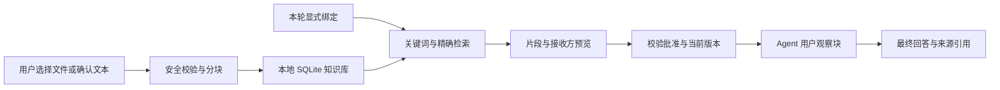

# 知识库 P0 实施说明

本阶段落实设计中的“可用的本地资料闭环”。本次开发基线为 `3ae318d28779d214fb13014069093cf55a43a97a`；经用户明确授权，交付流程为本地提交、保留 `d905fe09d7dddcff81590b1d8678c9603bd40228` 的待办与平台功能并以 `--no-ff` 合入本地 main、复验、清理本任务分支和 worktree。未刷新远程引用，不推送或创建 PR，两个原有 stash 原样保留。最终集成状态与验证原始输出见本地交付检查记录。

## 使用流程

1. 在工作台打开“知识库”，创建个人库或当前项目库。
2. 导入 Markdown / TXT 快照或创建笔记。原生选择器支持 UTF-8 文本；单文件不超过 256 KiB，确认前可查看正文预览及实际分块数量。成果中心的文本成果和会话最终回答也可经确认加入库，回答默认未经核实。
3. 在资料列表查看章节、行号、状态与版本；在检索验证页验证关键词命中。
4. 在对话输入区显式勾选知识库。项目和个人库分组显示，默认开启严格模式。没有选中的库时沿用普通会话。
5. 向远程模型发送资料时，先展示本轮全部片段及实际接收 origin / 模型，明确批准后发送。取消会恢复输入草稿。无命中且开启严格模式时，在本机结束本轮；未配置可用模型时只提供真实摘录。
6. 回答下的资料来源按钮打开实际命中的 `[K1]` 等片段，显示章节、行号和修订标识。停用资料可读取历史引用；删除资料后不再通过检索或引用读取正文。

## 实现边界

| 层 | 文件 / 职责 |
| --- | --- |
| 本地资料存储 | `crates/knowledge`：独立 SQLite/WAL、不可变修订、FTS5、中文检索词、精确匹配、绑定、引用、删除墓碑 |
| 桌面桥接 | `apps/desktop/src-tauri/src/knowledge.rs`：原生文件选择、作用域检查、快照确认、一次性发送令牌、运行中撤销校验 |
| Agent | `crates/agent/src/knowledge.rs`、`lib.rs`、`provider.rs`：引用观察块、严格空结果、无模型摘录、目的地限制、独立工具审批 |
| 会话历史 | `crates/core/src/session.rs`、`crates/shell/src/turn.rs`：可信知识轮次标记及桌面/CLI 统一历史过滤 |
| UI | `KnowledgeApp`、`KnowledgeSaveDialog`、`KnowledgeBinding`、`KnowledgeSources`、`ConversationPage`、`knowledgeApi` |
| 既有功能接入 | 工作台入口、成果文本提升、会话 DTO、CLI/evals/benchmark 的兼容字段 |

完整 DTO 和 IPC 见 [P0-CONTRACT.md](P0-CONTRACT.md)。没有安装新外部软件包，复用工作区已有 SQLite、serde、SHA-256、UUID 和桌面框架。



## 数据与发送约束

- 知识库位于应用状态目录的 `knowledge/v1/catalog.sqlite`，独立于 Memory 与工作台数据库。Unix 知识目录为 0700，数据库为 0600。SQLite 不提供默认加密，遵循主机用户权限和磁盘保护。
- 作用域基于规范化项目路径，授权会话操作以实际会话所属项目为准。SQL 在候选产生前约束项目和显式库列表。本期为单用户桌面能力，不声明多租户 ACL。
- 导入禁止 `.env*`、密钥、生产配置、运行日志、`.kodo`、sessions、secrets 与 credentials 路径。检查敏感内容与明显指令注入；触发隔离的内容不可直接启用。规则检测不能保证识别所有注入，因此模型指令与工具审批保持独立。
- 文件确认令牌绑定规范化路径、正文摘要、库及作用域，确认前重新读取；父目录转向、正文变化或令牌过期会拒绝确认。
- 模型发送令牌绑定原始问句、会话/项目、选库、实际 endpoint / 模型及可用状态。令牌五分钟有效且只能消费一次；既有会话解绑或切库会使旧令牌失效。
- 来源只作为用户消息中的引用数据。系统提示中只包含固定的信任与引用规则。每次模型请求和上下文压缩前复核应用开关、绑定及资料版本；撤销后停止后续使用，已经批准并发出的请求无法撤回。
- 知识轮次不写入普通 Memory outbox，也不自动召回 Memory。知识派生回答不会随桌面或 CLI 的后续历史再次发送。
- 禁用跨服务商回退及 persona 模型覆盖。模型 POST 不跟随 HTTP 重定向，自定义 endpoint 需直接指向 API；网页搜索仍须单独审批完整搜索词和 DuckDuckGo 目的地。
- 不新增遥测、云解析、云索引或远程日志。本次验证使用虚构文本与临时数据库，没有调用真实模型或发送项目资料。

## 验证与后续阶段

本次使用已安装的 Node v22.15.1。系统默认 Node v18 无法启动当前 Vite / rolldown；运行前应切换到已安装的兼容版本，无需为此安装新依赖。相关检查命令：

```bash
cargo fmt --all -- --check
cargo check --offline --locked --workspace --all-targets
cargo test --offline --locked -p kodo-core -p kodo-shell -p kodo-knowledge -p kodo-agent --lib
cargo test --offline --locked -p kodo-desktop --bin kodo-desktop

cd apps/desktop
npm run typecheck
npm run build
npm run test:visual -- --project=behaviour knowledge.spec.ts knowledge-conversation.spec.ts workbench.spec.ts
```

开发分支验收结果：Rust Agent 537 / Core 125 / Knowledge 12 / Shell 57 / Desktop 38 项通过，共 769 项；整个工作区 all-targets check、fmt、前端 typecheck/build 通过。知识管理、会话及工作台定向浏览器行为回归 42 项通过，相关视觉回归 5 项通过。

保留 `d905fe0` 后的集成工作区复验结果：Rust Agent 537 / Core 132 / Knowledge 12 / Shell 66 / Desktop 39 项通过，共 786 项；fmt、整个工作区 all-targets check、前端 typecheck/build 通过。定向浏览器行为回归 60 项通过，包含待办新增状态目录、排序和编辑行为；视觉回归 9 项通过，包含知识库、会话、工作台、成果、待办和日历。本次集成没有更新待办或日历截图。

完整浏览器行为套件为 306 项通过、11 项失败。将相同失败用例在 `3ae318d` 的只读前端副本复跑，11 项均复现；涉及 Inspector 默认展开状态、Memory 设置分类、执行记录可见性和进度文案的既有断言。本次未修改这些无关行为，也未把完整套件标为全绿。相关视觉基线仅更新知识库新增入口、回答/成果入库入口，新增知识库页面截图；待办和日历截图保持原样。

浏览器测试需启动当前工作目录的 Vite 服务；并行任务运行时应使用独立端口和临时 Playwright 配置，避免误连其他 worktree 的页面。本次使用 1423，基线对照为 1424。UI 验证使用演示资料和模拟 IPC；原生选择器、真实模型和安装包尚未做人工端到端验收。测试原始输出及 Git 现场记录保存在本地交付目录。

P1 的本地 Embedding、向量扩展、混合检索融合、重排及 PDF/DOCX 结构解析仍需单独确认依赖和模型分发，再基于统一语料做检索质量对照。P2 的后台来源维护、索引迁移与评测面板尚未实施。当前 UI 明确标为关键词检索，没有向量或 OCR 的效果声明。
